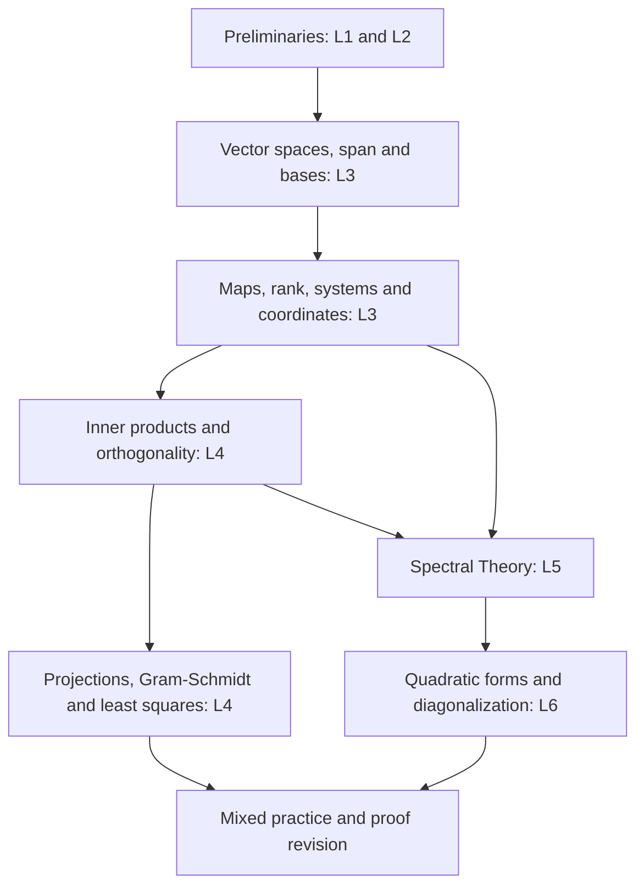

# Mathematical Methods: Linear Algebra Roadmap

A slide-led study plan for DSC-002, Delhi School of Economics. Start with the lecturer's slides, use the matching book passages to understand them, then solve problems and reconstruct proofs.

**Quick links:** [Complete topic checklist](topics.md) · [Easy / Medium / Hard priorities](priority.md)

## Scope and source status

This roadmap was checked against the files in this repository on 11 October 2026. Only topics actually present in the uploaded lectures are active study tasks. A book section is a place to look up those topics, not an instruction to finish every page or exercise in it.

The course has five headings: **Preliminaries, Foundation of Linear Algebra, Inner Product Spaces, Spectral Theory, and Quadratic Forms**. Systems of linear equations belong inside Foundation here.

- Available lectures: **L1–L6**, including the newly uploaded **L5 / Spectral Theory (23 slides)**.
- Spectral Theory is now fully traced to L5. The checklist contains **95 study units** across all six lectures, with a matching difficulty entry for each unit.
- L3 has 48 numbered slides plus a trailing blank PDF page. References below use the numbered slides; these match PDF pages 1–48.
- Treil's extract stops Chapter 1 at original page 30, where §7 Subspaces only begins. Use L3 slides 8–9 and Strang §2.1 for the available fuller treatment.
- The complex-number and orthogonal-complement handouts mentioned in L4 are not uploaded. The corresponding slide topics remain in scope.

## Learning flowchart

Arrows show the learning dependencies. Spectral Theory now has its own active block before Quadratic Forms.

## Slide-to-book roadmap

**T = Treil; S = Strang.** `Ch 2 §5` means section 5 of Chapter 2. PDF page links point into the uploaded extracts; they are not original textbook page numbers. Read only the named concepts that match the slides.

| Step | Slides / focus | Book passages to consult | Checkpoint before moving on |
|---|---|---|---|
| 1 | [L1 6–22: linear/affine ideas; row and column pictures](Sir-slides/002_LS-1_LA_prelim_-_intro%20%282%29_260831_161922.pdf#page=6) | [S Ch 1 §§1.1–1.2](Books-references/Strang_4th_Ed_Syllabus_Only_Linear_Algebra_260919_192540.pdf#page=4) | Explain Ax=b as both equations and a combination of columns. |
| 2 | [L2 2–27: logic, quantifiers, groups, rings, fields and vector-space introduction](Sir-slides/002_LS-2_LA_prelim_-_Logic_Group_theory%20%281%29_260831_161938.pdf#page=2) | [Slides are primary for logic and algebraic structures; T Ch 1 §1 supports vector-space axioms](Books-references/Treil_Syllabus_Only_Linear_Algebra_260927_184250.pdf#page=4) | Make truth tables; distinguish necessary/sufficient; justify a group or vector-space check. |
| 3 | [L3 2–16: vector spaces, dependence, span, subspaces, bases and dimension](Sir-slides/002_LS-3_LA_Foundation%20%282%29_260831_171354.pdf#page=2) | [T Ch 1 §§1–2 and beginning of §7; Ch 2 §5. S §§2.1, 2.3](Books-references/Treil_Syllabus_Only_Linear_Algebra_260927_184250.pdf#page=9) | Find a basis and explain why representation is unique; reconstruct the dimension argument. |
| 4 | [L3 17–26: linear maps, range, kernel, rank and nullity](Sir-slides/002_LS-3_LA_Foundation%20%282%29_260831_171354.pdf#page=17) | [T Ch 1 §3; Ch 2 §7. S §§2.4, 2.6](Books-references/Treil_Syllabus_Only_Linear_Algebra_260927_184250.pdf#page=55) | Compute rank/kernel and prove rank-nullity using an extended kernel basis. |
| 5 | [L3 27–41: systems, consistency, solution sets, row reduction and linear implicit function theorem](Sir-slides/002_LS-3_LA_Foundation%20%282%29_260831_171354.pdf#page=27) | [T Ch 2 §§1–3, 6–7; S §§1.3, 2.2. Use the slides for the linear implicit function theorem statement](Books-references/Treil_Syllabus_Only_Linear_Algebra_260927_184250.pdf#page=35) | Distinguish zero/one/infinitely many solutions; write x=x_p+z with z in the kernel. |
| 6 | [L3 42–48: matrix representation, basis changes, composition and similarity](Sir-slides/002_LS-3_LA_Foundation%20%282%29_260831_171354.pdf#page=42) | [T Ch 2 §8; Ch 1 §5 and inverse basics in §6. S §2.6](Books-references/Treil_Syllabus_Only_Linear_Algebra_260927_184250.pdf#page=65) | Build a transformation matrix from images of basis vectors and change its basis. |
| 7 | [L4 2–20: complex review, inner products, inequalities and orthogonal bases](Sir-slides/002_LS-4_Inner_product_spaces_260917_183627.pdf#page=2) | [T Ch 5 §§1–2; S §§3.1–3.2 for real geometry](Books-references/Treil_Syllabus_Only_Linear_Algebra_260927_184250.pdf#page=72) | Compute a complex inner product; prove Cauchy-Schwarz and triangle inequality. |
| 8 | [L4 21–32: projections, complements, residual maker and Gram-Schmidt](Sir-slides/002_LS-4_Inner_product_spaces_260917_183627.pdf#page=21) | [T Ch 5 §§2–3 and projection formula in §4; S §§3.1–3.4, relevant portions](Books-references/Treil_Syllabus_Only_Linear_Algebra_260927_184250.pdf#page=84) | Project onto a line/subspace, check the residual is perpendicular, and run Gram-Schmidt. |
| 9 | [L4 33–42: least squares, adjoints and fundamental subspaces](Sir-slides/002_LS-4_Inner_product_spaces_260917_183627.pdf#page=33) | [T Ch 5 §§4–5; S §§3.3, 3.1 and 2.4, relevant portions](Books-references/Treil_Syllabus_Only_Linear_Algebra_260927_184250.pdf#page=91) | Derive normal equations, state the full-rank assumption, and prove the range/kernel identities. |
| 10a | [L5 2-9](Sir-slides/002_LS-5_Spectral_theory_260914_234611.pdf#page=2): eigenvalues, eigenspaces, characteristic equation, trace/determinant, examples and similarity | T Ch 4 §1 (extract PDF pp. 102–108); S §5.1 (pp. 147–159), matching concepts only | Compute eigenpairs and eigenspace bases; check trace/product and explain similarity invariance. |
| 10b | [L5 10-17](Sir-slides/002_LS-5_Spectral_theory_260914_234611.pdf#page=10): symmetric-matrix results, orthonormal eigenvectors and repeated eigenvalues | L5 is primary for the symmetric-matrix proofs. T Ch 4 §§1–2 and S §§5.1–5.2 support eigenspaces and diagonalization, but their uploaded extracts do not contain a dedicated full symmetric spectral-theorem chapter. | Prove the real-eigenvalue and orthogonality results; find a basis for a repeated eigenspace. |
| 10c | [L5 18-23](Sir-slides/002_LS-5_Spectral_theory_260914_234611.pdf#page=18): diagonalization, distinct-eigenvalue induction proof, interpretation and orthogonal example | T Ch 4 §2 (extract PDF pp. 108–119); S §5.2 (pp. 160–169), matching concepts only; L5 for the orthogonal example | Construct S and D, verify AS=SD, and explain when S inverse equals S transpose. |
| 11 | [L6 2–8: bilinear/quadratic forms, congruence, diagonalization and range](Sir-slides/002_LS-6_Quadratic_Forms_260927_161009.pdf#page=2) | [T Ch 7 §§1–2, the orthogonal-diagonalization route; S §6.1, matching form/geometry passages](Books-references/Treil_Syllabus_Only_Linear_Algebra_260927_184250.pdf#page=121) | Convert a polynomial to xᵀAx; remove cross terms and explain why an invertible substitution preserves its range. |
| 12 | [L6 9–13: definiteness, leading minors, eigenvalue signs and plots](Sir-slides/002_LS-6_Quadratic_Forms_260927_161009.pdf#page=9) | [T Ch 7 §4: definitions, Theorem 4.1 and §4.1 Sylvester criterion; S §6.2, matching tests](Books-references/Treil_Syllabus_Only_Linear_Algebra_260927_184250.pdf#page=133) | Classify forms by eigenvalues; apply the positive-definite leading-minor test; interpret the graph. |

## How to study each block

1. Read the assigned slide range and write each definition in your own words.
2. Try the slide example before opening its solution.
3. If stuck, read the matching book passage. Strang is useful for geometric/numerical intuition; Treil for definitions and proofs.
4. Solve a few matching exercises: a direct calculation, a conceptual/counterexample question, and a proof where that block includes one. Do not select unrelated exercises merely because they share the same book section.
5. Close the material and explain the checkpoint above. Mark the topic complete only after you can do it without copying.
6. Revisit mistakes in the next session; use [priority.md](priority.md) to reserve more time for proof-heavy units.

A practical first pass is definitions and computations, followed by a second pass through the proofs. Hard does not mean optional. Keep the introductory Taylor/economics examples brief; they do not create separate calculus, optimization or game-theory chapters in this plan.

## What is parked for now

| Material visible in the books / outline | Current treatment |
|---|---|
| T Ch 7 §3: Sylvester's Law of Inertia | Listed in the course outline, but not explicitly developed in uploaded L6. Park it pending lecture coverage clarification. |
| T Ch 7 §4.2: minimax characterization and following interlacing material | Not developed in uploaded L6; parked. |
| T Ch 3: determinants | The course outline calls this reference-only. Consult characteristic-determinant computations for L5 and minors for L6; do not add a full determinant chapter. |
| Book-only material such as QR factorization, alternative quadratic-form elimination methods and unrelated applications | Not an active task unless it occurs in the cited slides. |
| Retained Strang solutions to unrelated chapters | Ignore; the presence of a solution in this extract does not extend the syllabus. |

## Reading cautions for the existing slides

These clarifications keep the plan mathematically consistent without adding new chapters:

- **L3 33:** “injective” means one-to-one; “into” by itself is not a synonym for injective.
- **L3 34–35:** the stated square-block condition is the standard guarantee for a unique solution for every right-hand side. For one fixed compatible right-hand side, a rectangular full-column-rank block can also give a unique solution. Check the intended quantifiers with the lecturer before memorizing the stated “iff.”
- **L4 25:** an orthogonal projection is singular when projecting onto a proper subspace. Projection onto the whole space is the identity and has determinant 1. In complex spaces use P*=P, not merely Pᵀ=P.
- **L6 2–3:** a bilinear form need not be an inner product. Over the reals, xᵀAx has the symmetric representative (A+Aᵀ)/2; this does not imply an arbitrary original A was symmetric.
- **L6 9–10:** the slides use “semidefinite” with an additional zero direction. Standard usage includes definite forms as semidefinite too; “singular semidefinite” expresses the slide's narrower case. Positive definiteness uses the n **leading** principal minors, not a claim that there are only n principal minors in total.

- **L5 2, 12:** an eigenvector is nonzero. A scalar multiple or linear combination is an eigenvector only if the result is nonzero; the eigenspace includes zero.
- **L5 5, 8:** complex roots and eigenvectors come in conjugate pairs when the matrix is real; this is not automatic for a general complex matrix.
- **L5 16–17:** the example matrix is not symmetric despite the slide header. Repeated roots alone do not ensure enough independent eigenvectors; compute the eigenspace dimension. The one-pivot result follows from these particular proportional rows, not merely from the columns being dependent.
- **L5 22:** full rank is unnecessary for a real symmetric matrix to have an orthonormal eigenbasis. Columns must be normalized as well as orthogonal for S to be an orthogonal matrix. Orthogonal changes may include reflections, not only rotations.

## Source files

- **L1**: [Lecture 1 - Linear Algebra Prelims](Sir-slides/002_LS-1_LA_prelim_-_intro%20%282%29_260831_161922.pdf).
- **L2**: [Lecture 2 - Logic and Group Theory](Sir-slides/002_LS-2_LA_prelim_-_Logic_Group_theory%20%281%29_260831_161938.pdf).
- **L3**: [Lecture 3 - Foundation of Linear Algebra](Sir-slides/002_LS-3_LA_Foundation%20%282%29_260831_171354.pdf).
- **L4**: [Lecture 4 - Inner Product Spaces](Sir-slides/002_LS-4_Inner_product_spaces_260917_183627.pdf).
- **L6**: [Lecture 6 - Quadratic Forms](Sir-slides/002_LS-6_Quadratic_Forms_260927_161009.pdf).
- **T**: [Treil - Linear Algebra Done Wrong (uploaded extract)](Books-references/Treil_Syllabus_Only_Linear_Algebra_260927_184250.pdf).
- **S**: [Strang - Linear Algebra and Its Applications, 4th ed. (uploaded extract)](Books-references/Strang_4th_Ed_Syllabus_Only_Linear_Algebra_260919_192540.pdf).

- **L5**: [Lecture 5 - Spectral Theory](Sir-slides/002_LS-5_Spectral_theory_260914_234611.pdf).
